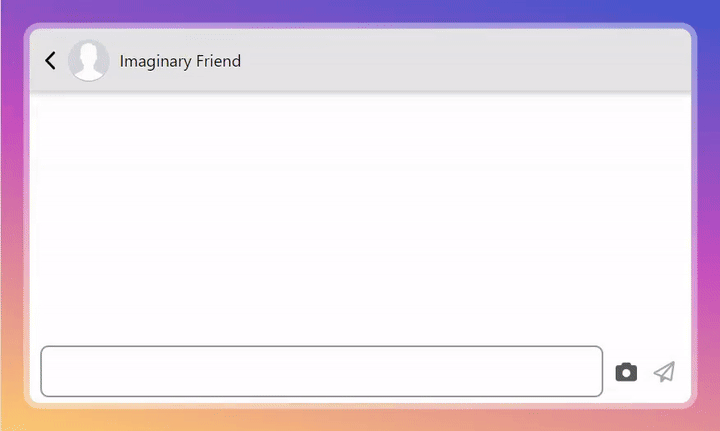
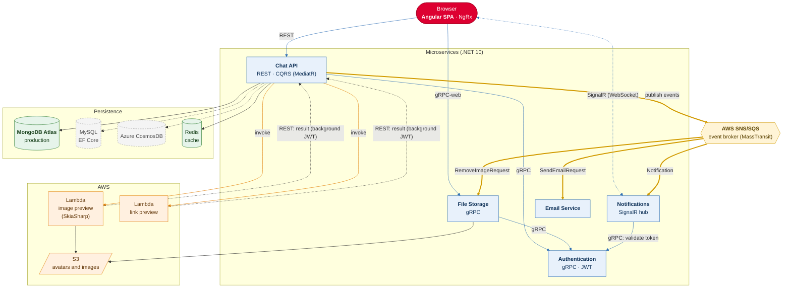

# LetsTalk - Instant messenger 💬




🔴 [Live demo](https://letstalk.petukhov.fyi/)

## Description

LetsTalk is a messaging app for exchanging text messages, images, and video calls.

## Technical stack

**Back end**
- C#, .NET 10, ASP.NET Core
- Communication: REST, gRPC, SignalR, WebRTC (Cloudflare TURN)
- CQRS: MediatR
- Databases: MySQL (Entity Framework Core), MongoDB, Azure CosmosDB, and Redis
- Event messaging: Apache Kafka, AWS SNS/SQS (via MassTransit)
- AWS: S3, Lambda, SNS, SQS, CloudWatch
- Azure: AppInsights, CosmosDB

**Front end**
- TypeScript, Angular 21, NgRx
- Testing: Vitest
- In progress: a new front end in `frontend-next/` (Next.js, React 19, Zustand, TanStack Query)

## Architecture

The diagram shows the production deployment, which uses managed cloud services wherever possible.



The front end is an Angular single-page application that uses NgRx for reactive state management. It talks to the Chat API over REST, to File Storage over gRPC-web, and receives real-time updates from Notifications over SignalR. (A new Next.js front end is in progress in `frontend-next/`.)

The back end follows a microservice, event-driven architecture. In production the event broker is AWS SNS/SQS, and image and link-preview processing runs in AWS Lambda functions that the Chat API invokes directly. The Chat API supports several persistence providers (MongoDB, MySQL via Entity Framework Core, Azure CosmosDB) behind one provider-neutral contract. Production uses MongoDB Atlas.

### Microservices

| Service        | Protocol             | Description                                                                                                                                                 |
| -------------- | -------------------- | ----------------------------------------------------------------------------------------------------------------------------------------------------------- |
| Chat API       | REST                 | Entry point for the front end: sends messages, manages accounts, profiles and sign-in. Publishes events and invokes the Lambda functions.                   |
| Authentication | gRPC                 | Generates and validates JSON Web Tokens. Called by the Chat API, File Storage and Notifications to validate the caller.                                     |
| Notifications  | AWS SNS/SQS, SignalR | Consumes new-message events and pushes them to the front end via SignalR. Validates each user's token through Authentication when the connection is opened. |
| File Storage   | gRPC, AWS SNS/SQS    | Saves avatars and images uploaded by users to AWS S3 and serves them on request. Consumes image-removal events.                                             |
| Email Service  | AWS SNS/SQS          | Consumes send-email events and sends emails, such as sign-in codes.                                                                                         |

### AWS Lambda functions

| Function         | Invoked by | Description                                                                                                                                         |
| ---------------- | ---------- | --------------------------------------------------------------------------------------------------------------------------------------------------- |
| Image processing | Chat API   | Generates image previews with [SkiaSharp](https://github.com/mono/SkiaSharp), stores them in S3, then reports the result to the Chat API over REST. |
| Link preview     | Chat API   | Decorates messages that contain links with the website's name and a picture preview, then reports the result to the Chat API over REST.             |

Both functions authenticate their callback with a separate one-hour background JWT, not the user's session token.

## Secure session management

Sign-in uses a one-time code sent by email. The session was hardened in two spec-driven steps (see [specs/001-httponly-cookie-auth](specs/001-httponly-cookie-auth/spec.md) and [specs/002-short-lived-token-refresh](specs/002-short-lived-token-refresh/spec.md)):

- **Credentials that scripts cannot read.** The access token lives in an `HttpOnly`, `SameSite=Strict` cookie, so an XSS flaw cannot steal it. The Angular app learns whether the user is signed in by asking the server.
- **Short-lived access tokens with silent renewal.** The JWT expires after 15 minutes. A separate rotating refresh token, also an `HttpOnly` cookie and scoped to the authentication endpoints, renews it without interrupting the user. The server stores only a hash of each refresh token.
- **Token theft detection.** Every renewal replaces the refresh token. If an already-replaced token is presented after a 30-second grace period (to tolerate several open tabs), the whole sign-in chain is revoked.
- **Real sign-out.** Logging out revokes the session on the server, so a copied token stops working in every service.
- **CSRF protection.** State-changing requests that carry the browser session are accepted only from configured origins, and CORS allows credentials only for an explicit list of origins. The same origin check covers the SignalR handshake.
- **Background jobs.** Lambda functions receive a separate one-hour token, so they keep working after the user's 15-minute token expires and never see the user's session.

## Local deployment

The instructions below are for Windows and set up the development configuration, which runs entirely on local resources: Kafka, MySQL, local disk storage, and the Image Processing and Link Preview services instead of Lambda.

### Prerequisites
- [.NET 10 SDK](https://dotnet.microsoft.com/download)
- [Node.js](https://nodejs.org/) and npm
- [Docker Desktop](https://www.docker.com/products/docker-desktop/) (`RunAll.ps1` starts the `redis` and `kafka` containers)
- [MySQL Server](https://dev.mysql.com/downloads/mysql/)
- PowerShell

### Back end
1. Create the Redis and Kafka containers. They must be named `redis` and `kafka`, because `RunAll.ps1` starts them by name, and must expose the default ports (6379 for Redis, 9092 for Kafka):
   ```powershell
   docker run -d --name redis -p 6379:6379 redis
   docker run -d --name kafka -p 9092:9092 apache/kafka
   ```

2. Install MySQL Server and make sure it is running on `localhost:3306`.

3. Set the MySQL user, host and database in the connection string (`ConnectionStrings:MySql`) if they differ from the defaults. It appears in two files:
   - `backend/Applications/LetsTalk.Server.API/appsettings.json`
   - `backend/Persistence/EntityFramework/LetsTalk.Server.Persistence.EntityFramework.MigrationTool/appsettings.json`

   The password is not stored in these files. Provide it in the `MySql:Password` setting, locally through the `LetsTalk_MySql__Password` environment variable (see [Secrets](#secrets)). Set the variable before you start the services (`RunAll.ps1`) or run `dotnet ef`, because a process only sees the variables that existed when it started. On a server, add `"MySql": { "Password": "..." }` to `appsettings.json` at deployment.

4. Create the database schema. Either restore a database backup, or apply the Entity Framework migrations. To apply the migrations, install the EF Core tool once and run the update from the MigrationTool folder:
   ```powershell
   dotnet tool install --global dotnet-ef
   cd backend\Persistence\EntityFramework\LetsTalk.Server.Persistence.EntityFramework.MigrationTool
   dotnet ef database update
   ```

5. Trust the ASP.NET Core development certificate (in an elevated PowerShell):
   ```powershell
   dotnet dev-certs https --trust
   ```

6. Create a user-level environment variables. Restart your terminal or IDE afterwards so it picks up the variable.
  - LetsTalk_ApplicationInsights__ConnectionString
  - LetsTalk_AutoMapper__LicenseKey
  - LetsTalk_Cloudflare__ApiToken
  - LetsTalk_Cloudflare__TurnTokenId
  - LetsTalk_FileStorage__BasePath
  - LetsTalk_JwtSettings__Key
  - LetsTalk_MediatR__LicenseKey
  - LetsTalk_SignPackage__Pepper
  - LetsTalk_MySQL__Password

7. Allow running local scripts in PowerShell:
   ```powershell
   Set-ExecutionPolicy -ExecutionPolicy RemoteSigned -Scope CurrentUser
   ```

8. Start all services:
   ```powershell
   cd backend
   .\RunAll.ps1
   ```

### Secrets

Secrets are not stored in the `appsettings.json` files. Every back-end service also reads the environment variables that start with `LetsTalk_`. The prefix is removed and `__` stands for a colon, so `LetsTalk_JwtSettings__Key` sets `JwtSettings:Key`. These values win over `appsettings.json` and over variables without the prefix. Set them for your user, then open a new terminal, because a process only sees the variables that existed when it started.

| Variable | Used for |
| --- | --- |
| `LetsTalk_JwtSettings__Key` | Signing key of the access tokens (Authentication service) |
| `LetsTalk_SignPackage__Pepper` | Pepper of the package signatures |
| `LetsTalk_MySql__Password` | Password of the MySQL user |
| `LetsTalk_Cloudflare__ApiToken`, `LetsTalk_Cloudflare__TurnTokenId` | TURN credentials for video calls |
| `LetsTalk_ApplicationInsights__ConnectionString` | Application Insights, needed only when `Features:Telemetry` is `Azure` |
| `LetsTalk_AutoMapper__LicenseKey`, `LetsTalk_MediatR__LicenseKey` | Library licence keys |
| `LetsTalk_FileStorage__BasePath` | Folder for local file storage |

The AWS, email, link preview and Cosmos DB settings (`Aws__AccessKey`, `EmailService__Password`, `LinkPreview__SecretKey`, `CosmosDB__PrimaryKey`, and so on) use the same scheme when you enable those features.

Telemetry is off by default: `Features:Telemetry` is `None` in `appsettings.json`, so the API starts without an Application Insights account. To send video-call telemetry, set `Features:Telemetry` to `Azure` (for example with `LetsTalk_Features__Telemetry=Azure`) and provide the connection string. With `Azure` and no connection string the API stops at start-up with a message that says so.

On a server, add the same sections (without the prefix) to `appsettings.json` at deployment, or use prefixed environment variables.

### Front end
1. Install mkcert (in an elevated PowerShell):
   ```powershell
   winget install FiloSottile.mkcert
   ```

2. Install the local certificate authority:
   ```powershell
   mkcert -install
   ```

3. Generate a certificate for `127.0.0.1` and `localhost`:
   ```powershell
   cd frontend
   mkdir certs
   mkcert -cert-file certs/127.0.0.1.pem -key-file certs/127.0.0.1-key.pem 127.0.0.1 localhost
   ```

4. Install dependencies and start the development server:
   ```powershell
   npm install
   npm run start
   ```

5. Open <https://127.0.0.1:4200>.