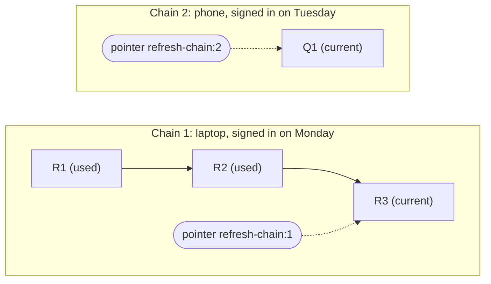
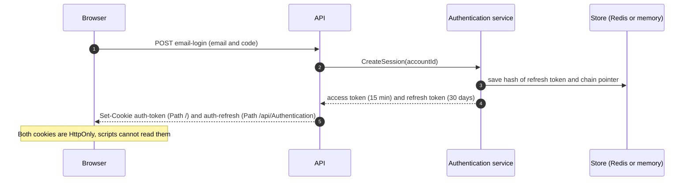
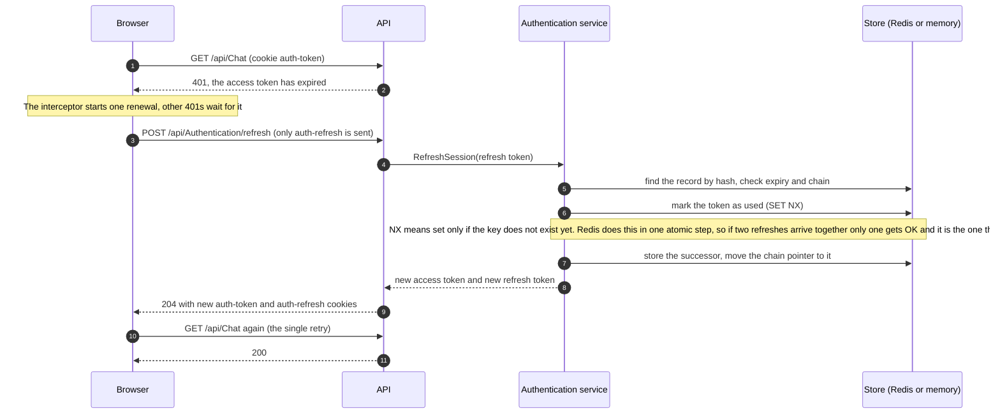
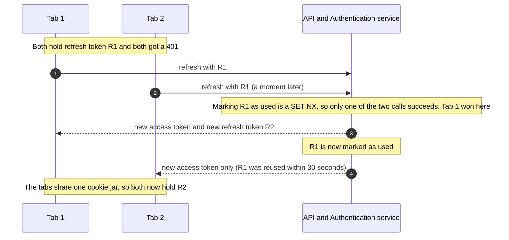
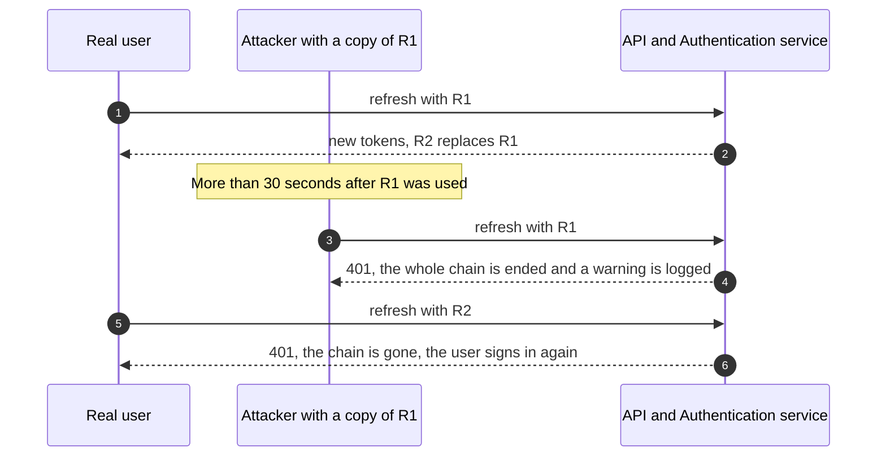
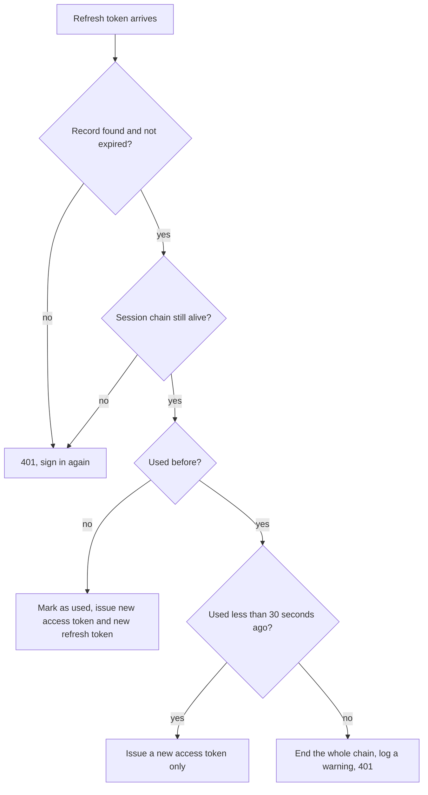
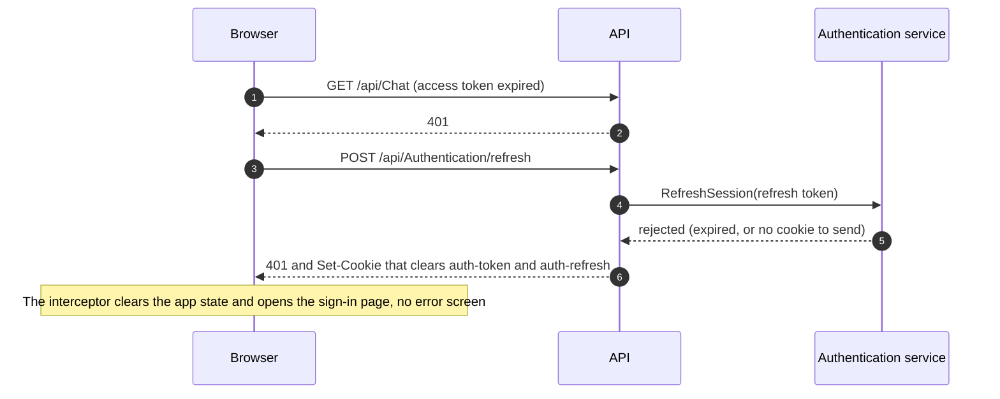

# Token refresh flow

How a signed-in user keeps working although the access token lives only 15 minutes. Illustrates [spec.md](spec.md) and [plan.md](plan.md) (D3, D4, D7). The diagrams are Mermaid, which GitHub renders.

## The two credentials

The browser holds **two cookies**. Both cookies are HttpOnly, `Secure` and `SameSite=Strict`. Page scripts can read neither. The refresh cookie is only sent to the sign-in, refresh and sign-out endpoints, because of its Path.

| | Access token | Refresh token |
|---|---|---|
| Cookie | `auth-token` | `auth-refresh` |
| Is | a signed JWT | 256 random bits; the server stores only its SHA-256 hash |
| Lives | 15 minutes | 30 days idle (restarts at each renewal), 90 days in total |
| Sent to | every API, file storage and notifications request (`Path=/`) | `/api/Authentication/*` only (`Path=/api/Authentication`) |
| Used for | proving which account sends the request | getting a new access token, once per refresh token |

## The session chain

Each refresh replaces the refresh token with a new one, so a single record only knows about itself. A chain ties together the refresh tokens that descend from one sign-in. A pointer always leads to the one that is valid now. Every device has its own chain.

- R1, R2, R3 (Chain 1, the laptop): the refresh tokens issued one after another to the laptop.
  - R1 is issued at sign-in on Monday.
  - R2 replaces R1 at the first refresh.
  - R3 replaces R2 at the second.
  - R1 and R2 are marked "(used)". They are still stored for a while, so a replay can be recognised. R3 is "(current)", the one the browser holds now, and the pointer `refresh-chain:1` leads to it.
- Q1 (Chain 2, the phone): the first and so far only refresh token of the phone's chain, signed in on Tuesday. It is current. The letter Q has no meaning; it just keeps the phone's tokens from being confused with the laptop's R tokens.

Ending chain 1 (sign-out on the laptop, or a replayed R1 or R2) follows the pointer, deletes R3 and the pointer, and leaves chain 2 untouched. The reasons are listed at the end of this page.

## 1. Sign-in starts a session chain

A session chain is the list of refresh tokens that descend from one sign-in. The store keeps one record per refresh token, plus a pointer to the current one.

## 2. Silent renewal when the access token expires (normal scenario)

The Angular interceptor catches the 401, renews once, and retries the original request once. Several requests that fail together share one renewal.

Every refresh replaces the refresh token, so each one works only once. The 30-day idle period restarts at each renewal, the 90-day limit does not.

## 3. Two tabs at once: the 30-second grace period

Two tabs can both get a 401 and both send the same refresh token. The first one wins. The second one is recognised as a harmless duplicate and only gets a new access token.

Without the grace period, the slower tab would look like a stolen token and sign the user out.

## 4. Stolen token: reuse after the grace period ends the whole session

If someone copied a refresh token and presents it after it was replaced, the server cannot tell the thief from the user. It ends the chain, so neither can continue. The user signs in again, the thief is locked out.

The warning log names the chain and account, never a token value. Signing out ends the chain in the same way.

## 5. What the server checks for each refresh token

## 6. When the refresh token itself expires, the user is sent to the sign-in page

A refresh token ends in one of two ways: 30 days without being used (idle), or 90 days after the sign-in (absolute). The browser then drops the cookie or the server rejects the record, and the result is the same.

An unreachable Authentication service is different: the API answers 503, and the app keeps the user signed in and retries later.

## Access and background tokens

The Authentication service issues two kinds of JWT (`TokenKind.ACCESS` and `TokenKind.BACKGROUND`). Both are the same signed JWT. They differ in lifetime and in who uses them.

| | `ACCESS` | `BACKGROUND` |
|---|---|---|
| For | the user's own requests from the browser | work the server does later on the user's behalf (image resizing, link previews) |
| Lifetime | 15 minutes (`AccessTokenLifetime`) | 1 hour (`BackgroundTokenLifetime`) |
| Where it goes | the `auth-token` cookie | in the broker message to the image and link consumers, never in a cookie |
| Who gets it | the browser, at sign-in and at every refresh | the API creates one when the user sends a message with an image or a link |

### Why a second kind exists

When a user sends an image or a link, the API puts a job on the queue (Kafka or SNS/SQS). The consumer and the Lambda later call the API with `Authorization: Bearer <token>` to save the result. That can happen minutes after the message was sent, or longer if the queue is backed up.

- If the job carried the user's access token, the token would often have expired by then, and the preview would fail with 401 (success criterion SC-005 asks that previews work even when processing takes up to 30 minutes).
- A separate token lives long enough to outlast the queue delay. The user's own token stays short-lived, and nothing in the browser can see the background one.

### What is built and what is not

- `GenerateJwtToken(kind)` in the Authentication service is built and tested. `ACCESS` is the default (value 0), so a call that does not set `kind` still gets a normal access token. `BACKGROUND` uses the longer lifetime.
- The API does not use it yet. `CreateMessageCommandHandler` still passes the user's access token to the launchers, and it will fail once access tokens last only 15 minutes. Task T127 switches it to `GenerateBackgroundTokenAsync` (Phase 2).

### One thing to be aware of

Once issued, a background token is accepted anywhere a normal token is, for its whole hour. There is no claim in it that limits what it can do. That is a known trade-off, listed in the plan's risk table: a narrow lifetime, carried only in the broker message, and the same trust boundary as before, when the same token lived for a year.

## Who calls the session calls, and when

`CreateSession`, `RefreshSession` and `EndSession` are gRPC methods of the Authentication service. The browser never calls them. The API calls them through `IAuthenticationClient`.

| Call | Called by | When |
|---|---|---|
| `CreateSession(accountId)` | `AuthenticationController.EmailLoginAsync` in the API (T124) | Once, at sign-in, after the email code is accepted. It returns the first access and refresh tokens, and the API sets both cookies. |
| `RefreshSession(refreshToken)` | the new `POST api/Authentication/refresh` endpoint in the API (T124) | When the browser's access token has expired. The Angular interceptor catches a 401 and calls it (Phase 5). |
| `EndSession(refreshToken)` | the logout handler, `LogoutCommandHandler` (T124) | At sign-out. It ends the chain, in addition to the existing token revocation. |

## Why a chain, not only tokens?

Each refresh token is replaced by the next one, so a record alone only knows about itself. The chain ties them together and is needed for:

- **Reuse detection.** When an old token is replayed, the server must find and kill the token that is valid now, because that is the one the real user (or the thief) holds. The pointer `refresh-chain:<chainId>` leads to it in one step.
- **Sign-out.** One call ends the session on that device, whichever refresh token the browser holds at the time.
- **The 90-day limit.** `ChainStartedAt` is copied from token to token, so the limit counts from the sign-in, not from the last renewal.
- **Separate devices.** Each sign-in has its own chain, so a sign-out or a reuse alarm on one device does not affect the others.

Without chains, the server would have to scan records or revoke everything of an account, which signs out all devices.

## What `SET NX` means

`NX` is a Redis option: set the key only if it does Not eXist. Redis does this as one atomic step, so of several simultaneous calls exactly one gets "stored" and the others get "already there". The server uses it to mark a refresh token as used: the first refresh wins and creates the successor, the others see the earlier time and are handled by the grace rule. In the code this is `StringSetAsync(key, value, ttl, When.NotExists)`; the in-memory store does the same under a lock.

## Lifetimes

All values are configuration (`JwtSettings` in the Authentication service). Development uses longer values so the experimental front end can use a pasted token.

| Setting | Default | Meaning |
|---|---|---|
| `AccessTokenLifetime` | 15 min | How long the access token is valid. After that the next request gets a 401 and the app renews. |
| `RefreshIdleLifetime` | 30 days | How long a refresh token stays valid unused. Restarts at every renewal. |
| `RefreshAbsoluteLifetime` | 90 days | Hard limit for one sign-in, however active the user is. |
| `RefreshReuseGrace` | 30 s | How long a replaced refresh token is still accepted, for access-token-only renewals. |
| `BackgroundTokenLifetime` | 1 hour | Separate token for image and link processing, so slow queues do not need the user's access token. |
